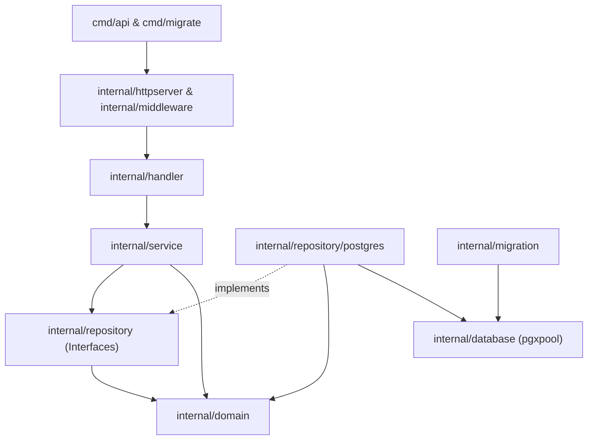
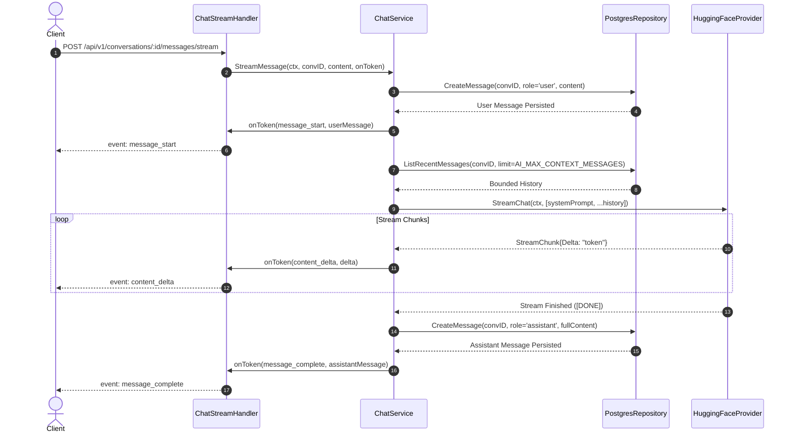

# Backend Architecture — AI Mini Chatbot

## 1. Layered Architecture Overview

The backend follows a strict layered architecture with unidirectional dependencies:

### Layer Responsibilities

1. **Entrypoints (`cmd/api`, `cmd/migrate`)**:
   - `cmd/api`: Loads configuration, initializes the single shared `pgxpool.Pool`, wires dependencies via constructor injection, runs the Gin HTTP server, and coordinates graceful shutdown on `SIGINT`/`SIGTERM`.
   - `cmd/migrate`: Standalone CLI for applying, inspecting, or rolling back versioned SQL migrations in `backend/migrations`.
2. **HTTP & Middleware (`internal/httpserver`, `internal/middleware`, `internal/handler`)**:
   - Configures Gin (`gin.New()`), recovery, structured logging, explicit origin CORS allowlist, and request body size limits (`1 MiB`).
   - Handlers translate HTTP requests/responses and delegate business logic to services.
3. **Service Layer (`internal/service`)**:
   - `ConversationService` and `MessageService` enforce domain invariants (UUID format, title trimming and 200-rune limit, role allowlist, non-blank message content, pagination bounds) before invoking repositories.
   - Independent of HTTP (`gin`) and SQL (`pgx`).
4. **Repository Layer (`internal/repository`, `internal/repository/postgres`)**:
   - Defines storage contracts (`ConversationRepository`, `MessageRepository`) in `internal/repository`.
   - Implements parameterized PostgreSQL queries and atomic transactions in `internal/repository/postgres`, translating `pgx` and SQLSTATE errors into `internal/domain` errors.
5. **Domain Layer (`internal/domain`)**:
   - Pure Go entities (`Conversation`, `Message`, `Role`, `Page`) and sentinel errors (`ErrConversationNotFound`, `ErrInvalidID`, `ErrInvalidTitle`, `ErrInvalidRole`, `ErrInvalidContent`, `ErrInvalidPagination`, `ErrInternal`).

---

## 2. Security & Reliability Foundations

- **Secret-Safe Logging & Errors**: `Config.String()`, `database.SanitizeError`, and `postgres.storageError` scrub database URLs, usernames, and raw/URL-encoded passwords so credentials never appear in logs or returned error strings.
- **Schema Isolation**: All tables (`conversations`, `messages`, `schema_migrations`) live in schema `chatbot`, with `anon` and `authenticated` privileges revoked so Supabase Data API cannot access application tables.
- **SSE-Ready Timeouts**: `ReadHeaderTimeout` (5s), `ReadTimeout` (15s), and `IdleTimeout` (60s) are enforced globally, while `WriteTimeout` is `0` to support Server-Sent Events streaming without premature disconnects. Per-request generation lifecycle is bounded by `AI_TIMEOUT` (default 60s).
- **Deployment Scope**: Authentication and row-level ownership are out of scope for MVP; the service is designed for trusted/private deployment until authentication is introduced.

---

## 3. AI & Streaming Architecture

Sprint 4 introduces streaming conversational AI integrated directly into the layered architecture:

### Key Architectural Invariants

1. **Provider Abstraction (`internal/ai`)**:
   - `ai.Provider` and `ai.Stream` define provider-agnostic interfaces.
   - `internal/ai/gemini` implements an official Google Gemini adapter utilizing the recommended Interactions API (`https://generativelanguage.googleapis.com/v1beta/interactions`) with `x-goog-api-key` header authentication and SSE streaming.
   - `internal/ai/huggingface` implements an OpenAI-compatible HTTP streaming client using standard Go `net/http` and `bufio.Reader` for SSE line parsing.
   - Provider selection is configured via `AI_PROVIDER=gemini|huggingface` without cross-provider fallback or silent switching.
   - Credentials (`GEMINI_API_KEY`, `HF_TOKEN`) and database secrets are scrubbed from all error strings before bubbling to the handler layer.
2. **Persistence Invariant**:
   - User message is saved immediately to PostgreSQL before the AI model is invoked.
   - Assistant message is persisted **only** if the generation completes without network errors, upstream timeouts, or client cancellation.
   - If the client disconnects or the AI provider fails mid-stream, the generation is aborted and no partial assistant message is saved.
3. **Bounded Context Assembly**:
   - `ListRecentMessages` fetches the latest `N` messages using `ORDER BY created_at DESC, id DESC LIMIT $2` subqueried into chronological `created_at ASC, id ASC`.
   - The assembled context is bounded to prevent token window overflow and control inference cost.
